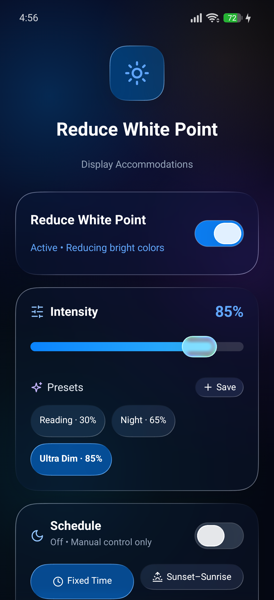

# Reduce White Point

**A lightweight, zero-idle-overhead Android Extra Dim / Reduce White Point utility featuring an iOS 26-inspired Liquid Glass Jetpack Compose UI.**


> **Device Compatibility:** Built and tested specifically on **ColorOS 17**. Behavior on other Android skins (Pixel/AOSP, One UI, HyperOS, etc.) has not been verified—some OEMs may expose or restrict `Settings.Secure` (`reduce_bright_colors_*`) differently.

---

## Screenshots & Demo

> *Replace these placeholders with captures from your device before publishing.*

| Main Liquid Glass UI | Draggable Switch & Intensity Slider | Quick Settings Tile |
| :---: | :---: | :---: |
|  |  |  |

---

## Core Features

- **Zero-Idle-Overhead Dimming Engine:** Drives Android's native `Settings.Secure` Extra Dim / Reduce Bright Colors pipeline (`reduce_bright_colors_activated` and `reduce_bright_colors_level`) with smooth `ValueAnimator` fade-in (`300ms`), fade-out (`260ms`, preserving your target percentage), and level transitions (`240ms`). No persistent `WindowManager` overlay, no foreground service, and zero idle wake-locks.
- **Quick Settings Tile (`TileService`):** Live active/inactive state and current percentage subtitle. Long-pressing the tile opens `MainActivity` directly via `ACTION_QS_TILE_PREFERENCES`.
- **Smart Scheduling:**
  - **Fixed Time:** User-defined start/end schedule (`TimePickerDialog`) with overnight wrap-around support.
  - **Sunset-to-Sunrise:** Pure NOAA astronomical solar calculation (`SolarCalculator`) using passive cached `LocationManager` coordinates when `ACCESS_COARSE_LOCATION` is granted, with automatic timezone-based fallback if denied.
  - **Boot Persistence:** Restores schedules cleanly on `BOOT_COMPLETED`, `TIME_SET`, and `TIMEZONE_CHANGED` via `AlarmManager` (`setExactAndAllowWhileIdle` when permitted, `setAndAllowWhileIdle` fallback).
- **Custom Glass Presets:** Built-in `Reading (30%)`, `Night (65%)`, and `Ultra Dim (85%)` pills plus user-saved custom presets (`0%–100%`) highlighted with `BlendMode.Hue` tinting and synced to dynamic App Shortcuts.
- **Home Screen Glance Widget:** Jetpack Glance widget (`WhitePointGlanceWidget`) with 1-tap `ON`/`OFF` toggle, `-10%` / `+10%` steps, and top 3 preset buttons.
- **App Shortcuts & Monochrome Icon:** Static and dynamic launcher shortcuts (`shortcuts.xml` + `ShortcutActionActivity`) and an Android 13+ Material You `<monochrome>` adaptive icon (`ic_launcher_foreground.xml` + `ic_launcher_monochrome.xml`).

---

## Liquid Glass UI & Performance Architecture

- **Optical Glass Pipeline (`Kyant0/AndroidLiquidGlass`):**
  - Renders an opaque radial-orb backdrop (`AmbientRefractiveBackground`) so refracted edges never sample transparent pixels.
  - Applies effects in strict order: `vibrancy()` → `blur(...)` → `lens(..., depthEffect = true, chromaticAberration = true)` (guarded on Android 13+ / API 33+).
  - Avoids RenderThread `SIGSEGV` recursion by passing `exportedBackdrop = cardBackdrop` on parent `LiquidGlassCard` containers instead of nesting `Modifier.layerBackdrop`.
  - Uses `rememberCombinedBackdrop` on both `LiquidGlassIntensitySlider` and `LiquidGlassSwitch` so the `Capsule()` glass droplet refracts the ambient/card backdrop and track simultaneously.
- **G2-Continuous Squircles (`Kyant0/Shapes`):** Uses `com.kyant.shapes.RoundedRectangle` and `com.kyant.shapes.Capsule` (`RoundedCornerStyle.Continuous`) across cards, switches, pills, and slider thumbs.
- **60Hz/120Hz Physics & Zero-Recomposition Hot Paths:**
  - `DampedDragState` pairs `VelocityTracker` flick detection with under-damped springs (`dampingRatio = 0.6f`, `stiffness = 320f`) and `layerBlock` scale/stretch transforms so the sampled backdrop never scales.
  - All state models (`DimmerState`, `DimPreset`, `ScheduleConfig`, `SolarTimes`) are marked `@Immutable`; drag values and animated alphas are read strictly inside `Modifier.offset { ... }`, `drawWithCache` / `onDrawBehind`, `layerBlock`, and `onDrawSurface`.
  - Continuous slider drags coalesce `SharedPreferences` writes (`160ms` throttle) and deduplicate integer `Settings.Secure` writes to avoid main-thread I/O stutters.
- **R8 & ART Baseline Profiles:** Release builds enable R8 full mode (`isMinifyEnabled = true`, `isShrinkResources = true`) with explicit keep rules (`proguard-rules.pro`) and an ART Baseline Profile (`app/src/main/baseline-prof.txt` + `androidx.profileinstaller:1.4.1`).

---

## Tasker, MacroDroid & ADB Automation

`WhitePointAutomationReceiver` (`com.whitepoint.reducer/.WhitePointAutomationReceiver`) is exported for external automation:

| Action | Purpose | Extras |
| :--- | :--- | :--- |
| `com.whitepoint.reducer.ACTION_CONTROL` | General command router | `command` (`toggle` \| `enable` \| `disable` \| `set_intensity` \| `apply_preset`), `intensity` / `level` (`Int` `0..100`), `preset` (`String`), `animate` (`Boolean`, default `true`) |
| `com.whitepoint.reducer.ACTION_TOGGLE` | Toggle dimmer ON/OFF | `animate` (`Boolean`) |
| `com.whitepoint.reducer.ACTION_ENABLE` | Enable dimmer (optionally set level) | `intensity` / `level` (`Int` `0..100`), `animate` (`Boolean`) |
| `com.whitepoint.reducer.ACTION_DISABLE` | Disable dimmer | `animate` (`Boolean`) |
| `com.whitepoint.reducer.ACTION_SET_INTENSITY` | Enable & fade to intensity | `intensity` / `level` (`Int` `0..100`), `animate` (`Boolean`) |
| `com.whitepoint.reducer.ACTION_APPLY_PRESET` | Enable & apply named preset | `preset` (`String`, name or id), `animate` (`Boolean`) |

### Ready-to-copy ADB test commands

```bash
# Toggle dimmer
adb shell am broadcast -n com.whitepoint.reducer/.WhitePointAutomationReceiver -a com.whitepoint.reducer.ACTION_TOGGLE

# Enable at 70% intensity with smooth fade
adb shell am broadcast -n com.whitepoint.reducer/.WhitePointAutomationReceiver -a com.whitepoint.reducer.ACTION_CONTROL --es command set_intensity --ei intensity 70

# Apply a named preset
adb shell am broadcast -n com.whitepoint.reducer/.WhitePointAutomationReceiver -a com.whitepoint.reducer.ACTION_APPLY_PRESET --es preset "Night"

# Disable dimmer
adb shell am broadcast -n com.whitepoint.reducer/.WhitePointAutomationReceiver -a com.whitepoint.reducer.ACTION_DISABLE
```

---

## How to Use

1. **One-time setup (ADB):** Install the APK, enable USB Debugging (and **Disable permission monitoring** in Developer options on ColorOS/OxygenOS), and run:
   ```bash
   adb shell pm grant com.whitepoint.reducer android.permission.WRITE_SECURE_SETTINGS
   ```
   *(The in-app setup card also lets you copy this command and tap **Re-check** once granted.)*
2. **Toggle & adjust intensity:** Tap or drag the **Reduce White Point** Liquid Glass switch, then drag or tap anywhere on the **Intensity** slider (`0%–100%`). Dragging while OFF lets you live-preview the dimming level on-screen.
3. **Use or save presets:** Tap **Reading (30%)**, **Night (65%)**, or **Ultra Dim (85%)**, or tap **+ Save** to store your current slider intensity as a custom glass pill (and dynamic App Shortcut).
4. **Quick Settings, Widget & Shortcuts:**
   - Pull down **Quick Settings** → **Edit** → add the **White Point** tile for 1-tap toggling (long-press the tile to open the app).
   - Long-press your home screen to add the **Reduce White Point** Glance widget (`ON`/`OFF`, `-10%`/`+10%`, and top 3 presets), or long-press the app icon for launcher shortcuts.
5. **Automate with Schedules:** Enable **Schedule** and choose **Fixed Time** (custom start/end times) or **Sunset–Sunrise** (uses coarse location if allowed, or timezone fallback).

---

## Build, Installation & Permissions

### Build from source

Requires **JDK 21** and **Android SDK 36** (`compileSdk = 36`, `minSdk = 31`, `targetSdk = 35`):

```bash
# Debug APK
./gradlew assembleDebug

# Minified Release APK (R8 + Resource Shrinking + Baseline Profile)
./gradlew assembleRelease
```

### One-time permission setup

```bash
adb install -r app/build/outputs/apk/debug/app-debug.apk
adb shell pm grant com.whitepoint.reducer android.permission.WRITE_SECURE_SETTINGS
```

> **Note:** On some OEMs (e.g., ColorOS / OxygenOS), enable **Disable permission monitoring** in **Developer options** before running `pm grant`.

### Declared Android Permissions

| Permission | Purpose |
| :--- | :--- |
| `android.permission.WRITE_SECURE_SETTINGS` | Modifies Android's native `reduce_bright_colors_activated` & `reduce_bright_colors_level` (no `SYSTEM_ALERT_WINDOW` overlay needed). |
| `android.permission.RECEIVE_BOOT_COMPLETED` | Reschedules active dimming alarms after device reboot. |
| `android.permission.SCHEDULE_EXACT_ALARM` | Optional exact alarm timing; falls back gracefully to `setAndAllowWhileIdle` if ungranted. |
| `android.permission.ACCESS_COARSE_LOCATION` | Optional passive coordinates for Sunset-to-Sunrise solar times; falls back gracefully to timezone estimation if denied. |

---

## Credits & Acknowledgments

- **[Kyant0/AndroidLiquidGlass](https://github.com/Kyant0/AndroidLiquidGlass)** (Apache-2.0 License) — `com.kyant.backdrop` Liquid Glass rendering, lens refraction, blur, vibrancy, and combined backdrop primitives.
- **[Kyant0/Shapes](https://github.com/Kyant0/Shapes)** (Apache-2.0 License) — G2-continuous squircle geometry (`com.kyant.shapes.RoundedRectangle`, `com.kyant.shapes.Capsule`).
- **[Lucide Icons](https://lucide.dev/)** (ISC License) — Clean open-source stroke vector icons.
- **[AndroidX / Jetpack Compose & Glance](https://developer.android.com/jetpack/compose)** (Apache-2.0 License) — Modern declarative UI toolkit, Glance AppWidget, and ART ProfileInstaller.

---

## License

Licensed under the [Apache License 2.0](LICENSE).
