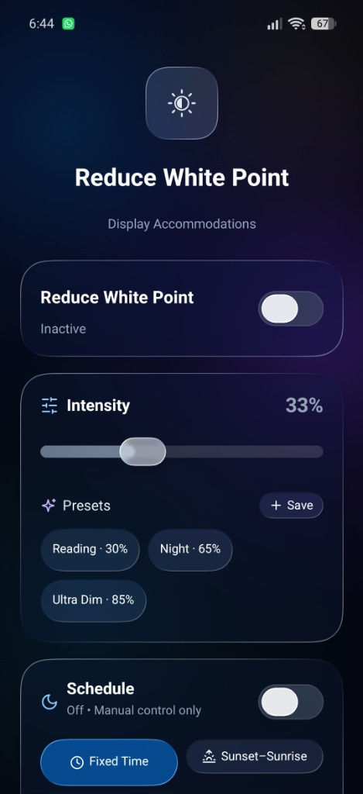
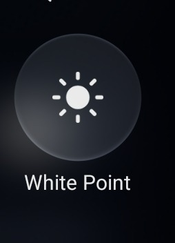

# Reduce White Point

**A lightweight Android Extra Dim / Reduce White Point utility with a Liquid Glass Jetpack Compose UI.**


[](https://github.com/Hopefull0/ReduceWhitePoint/releases/latest)

> **Disclaimer:** Built and tested specifically on **ColorOS 17**. Compatibility on other Android skins (Pixel/AOSP, One UI, HyperOS, etc.) is unverified—some OEMs may expose or restrict `Settings.Secure` (`reduce_bright_colors_*`) differently.

---

## Screenshots

| Main App UI | Quick Settings Tile |
| :---: | :---: |
|  |  |

---

## How to Use

1. **One-time setup (ADB):** Install the APK, enable USB Debugging (and **Disable permission monitoring** in Developer options on ColorOS/OxygenOS), and run:
   ```bash
   adb shell pm grant com.whitepoint.reducer android.permission.WRITE_SECURE_SETTINGS
   ```
   *(You can also copy this command from the in-app setup card and tap **Re-check**.)*
2. **Toggle & adjust intensity:** Tap or drag the **Reduce White Point** switch, then drag or tap anywhere on the **Intensity** slider (`0%–100%`). Dragging while OFF live-previews the dimming level.
3. **Presets:** Tap **Reading (30%)**, **Night (65%)**, or **Ultra Dim (85%)**, or tap **+ Save** to create custom presets.
4. **Quick Settings, Widget & Shortcuts:** Pull down **Quick Settings** → **Edit** to add the **White Point** tile (long-press the tile to open the app), add the home screen widget, or long-press the app icon for launcher shortcuts.
5. **Schedules:** Enable **Schedule** and choose **Fixed Time** or **Sunset–Sunrise**.

---

## Build & Permissions

Requires **JDK 21** and **Android SDK 36** (`compileSdk = 36`, `minSdk = 31`, `targetSdk = 35`):

```bash
./gradlew assembleDebug
./gradlew assembleRelease
```

| Permission | Purpose |
| :--- | :--- |
| `WRITE_SECURE_SETTINGS` | Controls Android's native `reduce_bright_colors_*` settings (no overlay window needed). |
| `RECEIVE_BOOT_COMPLETED` | Restores active schedules after reboot. |
| `SCHEDULE_EXACT_ALARM` | Optional exact schedule timing (falls back to `setAndAllowWhileIdle`). |
| `ACCESS_COARSE_LOCATION` | Optional passive coordinates for Sunset–Sunrise (falls back to timezone estimate). |

---

## Credits & License

- **[Kyant0/AndroidLiquidGlass](https://github.com/Kyant0/AndroidLiquidGlass)** (Apache-2.0) — `com.kyant.backdrop` Liquid Glass effects
- **[Kyant0/Shapes](https://github.com/Kyant0/Shapes)** (Apache-2.0) — G2-continuous squircle shapes
- **[Lucide Icons](https://lucide.dev/)** (ISC) — Vector UI icons
- **[AndroidX / Jetpack Compose & Glance](https://developer.android.com/jetpack/compose)** (Apache-2.0) — UI toolkit & AppWidget

Licensed under the [Apache License 2.0](LICENSE).
